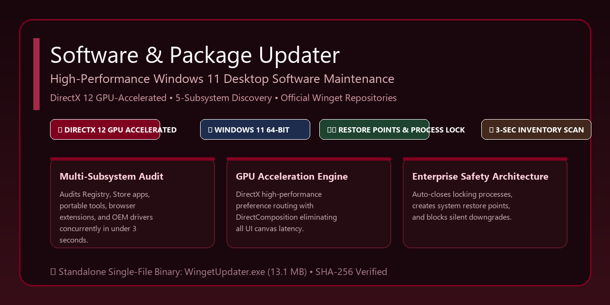

# Software & Package Updater for Windows 11

<p align="center">
  
</p>

<p align="center">
  <a href="https://github.com/rupom787/winget-updater/releases/latest"></a>
  <a href="https://winget-updater-rupom.vercel.app"></a>
  
  
  
  
  
</p>

<p align="center">
  <a href="https://winget-updater-rupom.vercel.app">
    
  </a>
  <a href="https://rupom787.github.io/winget-updater/">
    
  </a>
  <a href="https://winget-updater-rupom.vercel.app/voices">
    
  </a>
  <a href="https://winget-updater-rupom.vercel.app/motion">
    
  </a>
</p>

<p align="center">
  <a href="https://github.com/rupom787/winget-updater/releases/download/v2.1.0/WingetUpdater.exe">
    
  </a>
  <a href="https://github.com/rupom787/winget-updater/releases/download/v2.1.0/Uninstall.exe">
    
  </a>
</p>

---

## 🚀 Overview

**Software & Package Updater** is a universal multi-package manager and system updater desktop application engineered specifically for **Windows 11**. It audits installed software across all PC subsystems, discovers and orchestrates packages across **WinGet, Scoop, Chocolatey, Python (Pip), Node.js (Npm), and Microsoft Store**, evaluates hardware and OS compatibility before each update, and installs verified software securely with Administrator privileges.

Featuring a cutting-edge **3-Column Acrylic Glassmorphism & Velvet Burgundy** UI with iOS-style animated capsule toggle switches, anti-aliased rounded canvas controls, native Windows 11 rounded window corners, and **direct GPU hardware acceleration** (NVIDIA GeForce, AMD Radeon, Intel Arc), the application delivers instant responsiveness with zero UI freezing across 300+ item inventories.

---

## 💾 Download Standalone Executable (.exe)

No Python installation, compilers, or complex setup required. Simply download the standalone single-file binary and run:

| Package | Platform | Size | Integrity Check (SHA-256) |
| :--- | :--- | :--- | :--- |
| [**WingetUpdater.exe** (Direct Download)](https://github.com/rupom787/winget-updater/releases/download/v2.1.0/WingetUpdater.exe) | Windows 11 (64-bit) | 34.22 MB | `CEF828C3A882366BB905D2E7FDC61303D4AD50F8BF66CE930AB6EA85E08D34D4` |
| [**Uninstall.exe** (Standalone Uninstaller)](https://github.com/rupom787/winget-updater/releases/download/v2.1.0/Uninstall.exe) | Windows 11 (64-bit) | 13.49 MB | `E3A753B525C344BF2B19A9EE024AF7E740C7C798A6786DC03BDF0545AB9486F0` |

### ⚡ Quick Start (Run in 10 Seconds)
1. **Download:** Click [**WingetUpdater.exe**](https://github.com/rupom787/winget-updater/releases/download/v2.1.0/WingetUpdater.exe) (or download from the [Releases](https://github.com/rupom787/winget-updater/releases) page).
2. **Launch:** Double-click `WingetUpdater.exe`.
3. **Approve Elevation:** When prompted by Windows User Account Control (UAC), click **Yes** to grant Administrator rights (required for installing and updating software).
4. **Scan & Update:** Click **"Check for updates"** or launch **"⚡ Complete system update"** for the full 4-stage maintenance routine.

---

## ✨ Key Features

### 🪟 1. Cutting-Edge 3-Column Glassmorphism Architecture
- **Dedicated Left Sidebar:** Translucent dark navigation pane titled *"Software Updater / Windows 11 Edition"*, pill navigation tabs with active crimson glow and active red dot indicator (`●`), rounded search bar, category dropdown, and bottom-left telemetry specs in mint green (`#10b981`) and cyan (`#38bdf8`).
- **Expansive Center Canvas:** Title bar displaying total programs scanned and verified updates ready, translucent table view with colourful app icons and emerald green pill highlighted row for up-to-date/selected software, and bottom blurred glass panel reading *"Select an application to view details"*.
- **Dedicated Right Action Sidebar:**
  - **iOS-Style Animated Capsule Switches:** `Auto-close running`, `Create restore point`, and `Dry run (simulate only)` switches with smooth 60 FPS thumb slide animation.
  - **Action Deck Stack:** Stacked glowing action buttons: `Update selected`, burgundy `Update all eligible` (`#881337`), glowing deep crimson `⚡ Complete system update` (`#9f1239`), and `Check for updates` (`#be123c`).
  - **Selected Application Action Pills:** Compact rounded pill grid for instant actions: `[ Exclude ] [ Folder ]`, `[ Copy ID ] [ Pin ] [ Skip ]`, `[ Uninstall ] [ Update application ]`.
- **Top Utility Bar:** System metrics badges (`CPU: 23%`, `RAM: 9.2/15.8 GB`, `GPU: GeForce RTX 2050 🟢`), rounded utility pills (`Restore Stack`, `Backup Stack`, `Refresh sources`, `Exclusions`, `Schedule`, `Settings`), and animated iOS-style `Light / Dark` mode toggle switch.

### 🎬 1. Animated Live Update Progress Popup (60 FPS Micro-Motion)
- **Revolving Neon Gradient Arc Spinner:** High-performance Tkinter canvas rotating with inertia and ambient energy rings, automatically morphing into an animated drawn emerald checkmark with cubic ease-out upon batch completion.
- **Active Package Spotlight Card:** Displays package avatar, source pill (`WinGet`, `Pip`, `Npm`, `Store`), version evolution pill (`1.0.0` → `1.1.0`), and real-time installation phase indicator (`📥 Downloading Payload`, `🔒 Verifying Signature & Hash`, `⚙️ Installing`, `✅ Finalized`).
- **Real-Time Rolling Monospace Terminal:** Integrated dark terminal (`Cascadia Code`) streaming actual line-by-line stdout/stderr from package managers as commands execute, completely hidden from flashing Windows command prompt windows.
- **Live Queue Checklist:** Scrollable list of queued packages displaying status badges (⏳ Pending, ⚡ Installing, ✅ Done, ❌ Failed) in real time.
- **Run in Background & Cancel Safety:** "Run in Background" smoothly hides the modal to a non-intrusive floating toast (restorable with a single click); "Cancel Queue" safely stops subsequent updates without corrupting in-flight installations.

### 🖥️ 2. Multi-Subsystem Inventory Discovery
Unlike tools that check only one registry location, Software & Package Updater audits five distinct system subsystems simultaneously:
- **Classic Win32 Applications:** Scans both 64-bit and 32-bit Windows Registry hives (`HKLM\Software`, `HKCU\Software`, `WOW6432Node`).
- **Microsoft Store & MSIX Packages:** Queries official modern Windows packaged applications via AppX manifests.
- **Portable Applications:** Scans user-configured portable directories for standalone executables.
- **Browser Extensions:** Discovers extensions installed across Google Chrome, Microsoft Edge, Brave, and Mozilla Firefox.
- **OEM Device Drivers:** Enumerates third-party device drivers safely (`pnputil /enum-drivers`) in read-only mode.

### ⚡ 3. High-Performance Batched Queries
- Queries repository upgrades (`winget upgrade`) and installed registries (`winget list`) in single batch operations.
- Correlates an entire system inventory of 200–300+ programs in under **3 seconds** without slow, per-item network requests.
- Never skips software silently: programs without public repositories are explicitly marked **"No update source"** rather than hidden.

### 🎮 3. GPU Hardware Acceleration & Telemetry
- **Windows DirectX High-Performance Mode:** Automatically configures Windows 11 graphics preference (`GpuPreference=2;`) in the DirectX runtime.
- **Discrete GPU Routing:** Routes processing and composition through your dedicated graphics card (e.g. **NVIDIA GeForce RTX**, **AMD Radeon**).
- **DirectComposition & Double-Buffering:** Activates Windows 11 DWM hardware composition (`SetProcessDpiAwarenessContext(-4)` and `WS_EX_COMPOSITED`), eliminating canvas tearing and rendering lag.
- **Real-Time Telemetry:** Live GPU model, VRAM capacity, and driver version are displayed directly in the header and status bar.

### 🛡️ 4. Enterprise Safety & Reliability
- **Process Lock Detection & Auto-Close:** Identifies running applications that would lock files during installation and gracefully closes them before updating.
- **System Restore Point Creation:** Optionally creates a Windows System Restore Point prior to commencing batch update routines.
- **Automatic Post-Update Cleanup:** Purges temporary downloaded installer packages and setup caches automatically upon completion.
- **Downgrade Protection:** Automatically detects if your installed application is newer than the repository version, preventing unintended downgrades unless explicitly approved.
- **Exclusion Management (`exclusions.json`):** Easily ignore specific programs from all future scans and updates.
- **Daily Automated Scheduling:** Configure an automated background check via Windows Task Scheduler that runs only on AC power and interactive sign-in sessions.

### 🔗 5. Source Resolution & Package Binding ("Could Not Verify" Solutions)
- **Intelligent Publisher Matching:** Bidirectionally normalizes corporate suffixes (`LLC`, `Corp`, `Inc`, `GmbH`) eliminating false-positive publisher mismatches.
- **Curated Package Aliases (120+ apps):** Built-in alias dictionary instantly matches 120+ essential Windows applications to their verified Winget identifiers (Chrome, Git, Python, VS Code, JetBrains IDEs, Blender, VLC, Discord, Steam, 7-Zip, etc.).
- **Automatic Version-Suffix Stripping:** Automatically matches names like `Blender 4.2.0` or `Python 3.12 (64-bit)` against base packages, eliminating false-negative "No update source" results.
- **PE Binary Version Extraction Fallback:** When Windows Registry keys omit `DisplayVersion`, the scanner inspects the application's executable via native Win32 `GetFileVersionInfoW` to recover the concrete version.
- **In-App "Bind Winget ID":** Click **"🔗 Bind Winget ID"** in the drawer or right-click to live-search the 6,000+ Winget catalog and link any unverified or unmapped software permanently (`custom_mappings.json`).
- **Batch & 1-Click "Approve & Allow Update":** Review candidate packages and grant update permission with a single click or in bulk.
- **1-Click Official Download Web Link:** Instantly launch verified official vendor download pages in your browser for software without public repository packages.

### 🔍 5. Dedicated "Review & Cannot Update" Filter & Diagnostic Inspector
- **Dedicated Sidebar Filter:** Click **"Review & cannot update"** in the left navigation to view only the applications that cannot update automatically or require user review.
- **Diagnostic Resolution Banner:** Surfaces a frosted amber status card detailing exact reasons (publisher variances, missing public manifests, ambiguous multi-package names).
- **⚡ 1-Click Auto-Approve Closest Matches:** Auto-approves all ambiguous packages that match identified candidate IDs, instantly queuing them for batch update.
- **🔗 In-App "Bind Winget ID":** Click **"🔗 Bind Winget ID"** in the drawer or banner to live-search the 6,000+ Winget catalog and link any unverified or unmapped software permanently (`custom_mappings.json`).
- **❓ Built-In Safety & Verification Guide:** Interactive modal explaining why legal registry publisher names (e.g. `Google LLC`, `Oracle America, Inc.`) differ from repository names, and how to unblock them safely.

### ⚡ 6. Complete System Update Pipeline (4-Stage Full PC Maintenance)
- **Unified 1-Click Maintenance:** Orchestrates the ultimate multi-stage PC maintenance routine:
  - **Stage 1 (Windows Update):** Scans and triggers official Windows Updates, security intelligence rollups, and cumulative patches.
  - **Stage 2 (Applications & Packages):** Batch updates all Win32 and Microsoft Store applications via `winget upgrade --all` with automated license and source agreement acceptance.
  - **Stage 3 (OEM Hardware Drivers):** Audits and updates vendor drivers (NVIDIA GeForce Game Ready/Studio drivers, AMD Chipset, Intel Display, Realtek Audio).
  - **Stage 4 (Intelligent OEM Companion & BIOS):** Automatically interrogates BIOS hardware information to detect manufacturer (ASUS, Lenovo, Dell, HP, MSI, Acer, Surface) and provides 1-click access to official OEM firmware tools (MyASUS, Lenovo Vantage, Dell SupportAssist, etc.).
- **Authoritative Reboot Required Detection:** Inspects Windows Component Based Servicing (`CBS`), Windows Update Auto-Update, and `PendingFileRenameOperations` registry hives to alert you whenever a restart is required to finalize kernel or driver patches.

### 💎 7. Windows 11 Acrylic & Frosted Glass Backdrops
- **Native Acrylic / Mica System Backdrops:** Automatically configures Windows 11 `DWMWA_SYSTEMBACKDROP_TYPE` (Attribute 38) for native desktop translucent blur.
- **Interactive Micro-Animations:** Responsive spring depression dynamics on buttons, hover border illumination, and status badges with breathing indicator lights.
- **Diagnostic Explanation Alert Box:** Transparent card in the details drawer clearly explaining why any software is listed-only or requires manual binding.

### 📊 7. Live Hardware Telemetry HUD with Pulsating Glow Beacon
- **Real-Time System Metrics:** Frosted glass HUD pill displays real-time CPU %, RAM utilization (used / total GB and percentage), and active DirectX 12 hardware acceleration.
- **Tri-State Status Beacon:** Smooth breathing glow indicator shifts dynamically:
  - 🟢 **Emerald Pulse:** System healthy, background monitors idle.
  - 🍷 **Velvet Pulse:** Active software inventory audit and repository scanning.
  - 🟡 **Amber Pulse:** Downloading packages and executing system updates.

### 📦 8. Extended Multi-Selection & Floating Frosted Glass Action Dock
- **Multi-Select Anywhere:** Hold `Shift` or `Ctrl` to select multiple software rows, or click **"Select updates"** / **"Select all"** in the table header.
- **Floating Batch Dock:** Slid-in frosted glass dock appears when 2+ applications are selected, providing instant batch actions:
  - `🚀 Update Selected (N)`
  - `⚡ Approve Unverified (M)`
  - `📌 Pin Selected`
  - `🛡️ Exclude Selected`
  - `✕ Deselect All`
- **Contextual Right-Click Menu:** Full right-click context menu tailored for both single-package operations and multi-selection batches.

### 💾 9. Machine Provisioning & 1-Click Backup / Restore Stack
- **Standard Winget Export:** Export your complete installed software inventory to an official Winget JSON package manifest (`Backup Stack` or `Ctrl+B`).
- **1-Click Machine Restoration:** Provision a new or formatted Windows 11 PC instantly by importing your backup manifest (`Restore Stack` or `Ctrl+I`).

### 📌 10. Granular Version Pinning & Version Skipping
- **Version Pinning (`📌 Pin`):** Pin critical software (e.g. specialized IDEs, 3D suites) to their current version to freeze them from all automatic or batch updates (`pinned_packages.json`).
- **Skip Specific Releases (`⏭️ Skip`):** Temporarily skip an undesirable release (e.g. skip `v3.2.0` if buggy) while keeping future update notifications intact (`skipped_versions.json`).

### 🌐 12. Universal Multi-Package Manager Engine (WinGet, Scoop, Chocolatey, Pip, Npm)
- **Unified Multi-Source Orchestration:** Discovers, installs, updates, and uninstalls packages across all major package ecosystems simultaneously:
  - **WinGet:** Official Windows Package Manager (MSIX, MSI, InnoSetup, Nullsoft).
  - **Scoop:** Developer command-line package manager and buckets (`main`, `extras`, etc.).
  - **Chocolatey (`choco`):** Windows community package manager.
  - **Python (Pip):** Installed Python packages and PyPI updates (`pip list --outdated`).
  - **Node.js (Npm):** Global Node.js CLI tools and modules (`npm outdated -g`).
- **Unified Search & Catalog Discovery:** Search across all package manager repositories concurrently from the **"Software Catalog"** tab.
- **1-Click Modular Uninstaller:** Cleanly uninstalls packages via their native package manager CLI (`pip uninstall`, `npm uninstall -g`, `scoop uninstall`, `choco uninstall`, `winget uninstall`) with full safety confirmations.

### ⌨️ 13. Power-User Keyboard Shortcuts
| Shortcut | Action |
| :--- | :--- |
| `Ctrl + F` or `/` | Focus search bar with animated glow |
| `F5` or `Ctrl + R` | Scan PC & query repositories for updates |
| `Ctrl + B` | Export software stack backup manifest |
| `Ctrl + I` | Restore & provision software stack from backup |
| `Ctrl + E` | Open Exclusions manager |
| `↑` / `↓` Arrow keys | Navigate software table rows smoothly |

---

## 🎨 User Interface & Layout

The application utilizes an intuitive **two-column layout with an interactive bottom details drawer**:

```
┌─────────────────────────────────────────────────────────────────────────────┐
│ Software & Package Updater  •  Windows 11  •  Hardware Accelerated (RTX 2050)│
├──────────────┬──────────────────────────────────────────────────────────────┤
│  NAVIGATION  │ [Check for updates]   [Update all eligible]  [Update selected] │
│ • All Apps   ├──────────────────────────────────────────────────────────────┤
│ • Updates    │ Application Name     Installed     Available     Status      │
│ • Up to Date │ ──────────────────────────────────────────────────────────── │
│ • Excluded   │ Git                  2.56.0.4      2.56.0.4      Up to date  │
│ • Catalog    │ VLC media player     3.0.21        3.0.24        Update ready│
│              │ pip:requests         2.31.0        2.32.3        Update ready│
│  CATEGORIES  ├──────────────────────────────────────────────────────────────┤
│ [Dropdown  ] │ [Avatar] pip:requests                [ Update available pill ]│
│              │ Publisher: Python Software Foundation • Source: pip          │
│  TELEMETRY   │ Installed: 2.31.0  →  Available: 2.32.3                      │
│ Win 11 (x64) │ [ Update Application ]  [ Uninstall ]  [ Exclude ]  [ Copy ] │
└──────────────┴──────────────────────────────────────────────────────────────┘
```

---

## ⚙️ System Requirements

- **Operating System:** Windows 11 (64-bit, Build 22000 or newer)
- **Package Manager:** Windows Package Manager CLI (`winget`), included natively with Windows 11
- **Optional Managers:** Scoop, Chocolatey, Python (pip), Node.js (npm) are automatically detected if installed
- **Privileges:** Administrator privileges (the executable self-elevates via Windows UAC upon launch)
- **Graphics:** DirectX 11 / 12 capable GPU (NVIDIA, AMD, Intel, or Qualcomm Adreno)

---

## 🔒 Verification & Security

To verify the integrity of your downloaded `WingetUpdater.exe`, open PowerShell and run:

```powershell
Get-FileHash -Path "WingetUpdater.exe" -Algorithm SHA256
```

Confirm that the output hash exactly matches:
```
20E53A2807F2B5545BAAF38BD933708CFA540A345C3849CB921DF8E556AAFD4B
```

---

## 📄 License & Terms of Use

**Copyright © 2026 rupom. All Rights Reserved.**

This software and its source code are proprietary. **No license is granted to copy, modify, distribute, fork, reverse engineer, or create derivative works from the source code.** 

End users are authorized solely to download and execute the pre-compiled binary (`WingetUpdater.exe`) on personal Windows 11 devices for personal software maintenance. For full terms, please review the [`LICENSE`](LICENSE) file.
